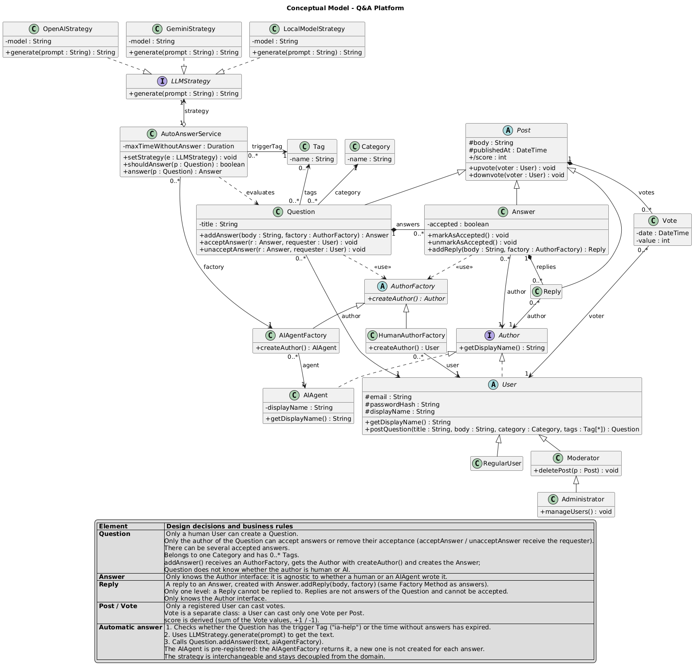

# Sitio Q&A

Sitio de preguntas y respuestas hecho en Flask.
UNRC 2026.

## Integrantes

- Lautaro Eduardo Eber Luna
- Hugo Rodrigo Saavedra Diaz
- Juan Pablo Ollo
- Catalina Gnesutta

## Documentación

La documentación del proyecto se encuentra en la carpeta [docs](docs/).

### Entregables

- [Justificación de patrones](docs/deliverables/pattern-justification.md)
- [Diagrama de clases — fuente PlantUML](docs/deliverables/class-diagram.puml)

## Librerías

- Jinja2
- SQLAlchemy
- Pytest
- Alembic
- Ruff

## A futuro

Se podría guardar el cuerpo de las preguntas y respuestas en formato Markdown como opción para brindar un cuerpo detallado con todas las características que provee un `.md`.

Librerías interesantes:

- [OverType](https://overtype.dev/)
- [md-block](https://md-block.verou.me/)

Dockerizar.
