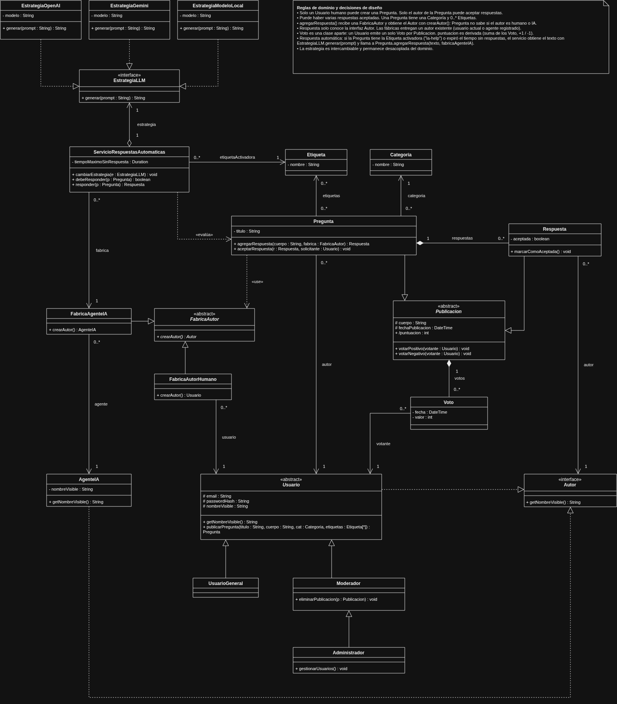

# Sitio Q&A
Sitio de preguntas y respuestas hecho en flask.
UNRC 2026.

## Integrantes
- Lautaro Eduardo Eber Luna
- Hugo Rodrigo Saavedra Diaz
- Juan Pablo Ollo

Nota de @lau-luna: 
agregué una nueva línea después de Juan Pablo Ollo y en el blame aparece que modifiqué esa linea yo,
pero Juan Ollo añadió su nombre en el commit [f986ef2](https://github.com/lau-luna/proyecto-isi/commit/f986ef25c593fb157e2b25b434900e6e7525a44c)

## Documentación
La documentación del proyecto se encuentra en la carpeta [docs](docs/).

### Diagrama de Clases
[Diagrama](docs/class-diagram.drawio)

[Justificación Patrones](docs/justificacion-patrones.md)

## Librerias
- Jinja2
- SQLAlchemy
- Pytest
- Alembic
- Ruff

#### A futuro
Se podría guardar el cuerpo de las preguntas y respuestas en formato markdown como opción para brindar un cuerpo detallado con todas las características que provee un .md

Librerias interesantes:
- [OverType](https://overtype.dev/)
- [md-block](https://md-block.verou.me/)

Dockerizar
